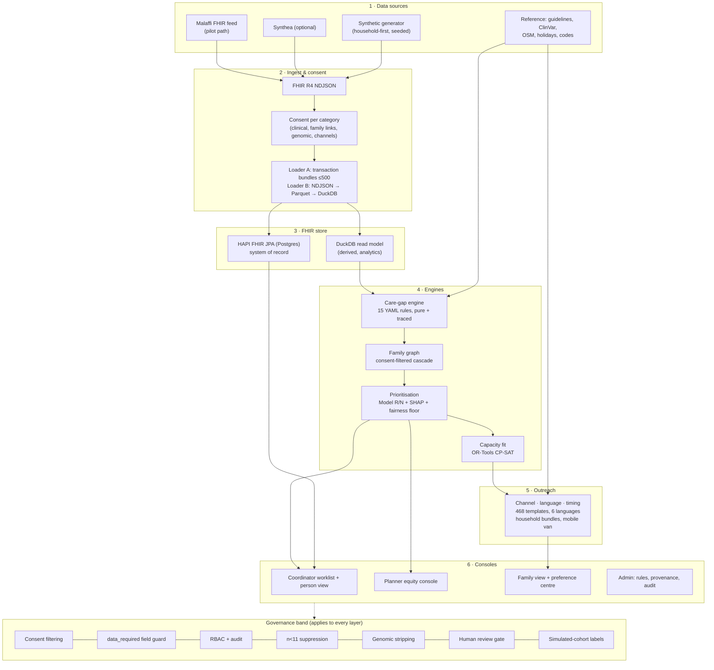
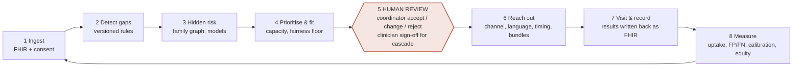

# Architecture

Wiqaya is a population-health layer that runs beside the clinical record. It reads FHIR, finds care gaps with
versioned rules, finds hidden risk through family links and past results, ranks outreach to fit real capacity, and
measures its own equity. **It only reorders outreach. It never diagnoses or changes a clinical pathway.**

## Six layers, with a governance band

## The eight-step loop (human gate at step 5)

## Components and where they live

| Layer | Component | Code |
|---|---|---|
| Data | Synthetic generator (households, people, family, latent truth, 24-month history, consent, personas) | `src/wiqaya/generator/` |
| Data | FHIR R4 mapping, NDJSON, HAPI loader (sample / full) | `src/wiqaya/fhir/` |
| Store | NDJSON → Parquet → DuckDB; repository layer; hidden-truth guard | `src/wiqaya/store/` |
| Engine | Rule schema, pure evaluator, field-guarded snapshots, bulk runner | `src/wiqaya/rules/` |
| Engine | Consent-filtered family graph, cascade links | `src/wiqaya/graph/` |
| Engine | Features, LightGBM + isotonic, SHAP phrases, priority, fairness floor | `src/wiqaya/models/` |
| Engine | Slot supply, two-stage CP-SAT fit, household bundling | `src/wiqaya/capacity/` |
| Outreach | Library + validator, contact planning, rendering, timing, orchestrator | `src/wiqaya/outreach/`, `src/wiqaya/common/calendar.py` |
| Evaluation | 12-week simulator (common random numbers), metrics, report | `src/wiqaya/simulate/`, `src/wiqaya/evaluate/` |
| Governance | Suppression, overlays, audit, provenance register | `src/wiqaya/governance/` |
| API | FastAPI `/api/v1`, guest sessions, RBAC | `src/wiqaya/api/` |
| Web | Next.js 14 consoles | `web/` |

## Data flow and stores

- **FHIR is the system of record.** HAPI FHIR (R4, Postgres) holds every resource type:
  - `Patient`, `Group` (household), `RelatedPerson`, `Encounter`, `Appointment` (no-shows), `Observation` (BP as LOINC 85354-9 panels; genomic findings as LOINC 69548-6), `Condition`, `Immunization`, `FamilyMemberHistory`, `Consent` (one per category), `Communication`, `Organization`/`Location` (generic clinics, van stops) and `DetectedIssue` (care gaps).
  - The default `FHIR_LOAD=sample` loads the demo personas plus about 2,000 people. `FHIR_LOAD=full` loads everyone.
- **DuckDB is the derived read model.** It is flattened from the same NDJSON. The engines only read DuckDB, through `store/repo.py`.
- **Person pages read HAPI first.** If HAPI is down or the person is not in the sample, they fall back to DuckDB and show a banner.
- **Hidden ground truth** (`data/hidden/latent_truth.parquet`) is readable only by the generator, the simulator and the evaluator. `repo.load_latent` enforces this.
- **Pilot path:** loader A is replaced by a Malaffi FHIR read through the same client. The engines do not change.

## Determinism

One seed per stage (`numpy.random.SeedSequence.spawn`). CP-SAT runs with one worker and a deterministic time budget,
and the simulator's random draws come from SHA-256 hashes. The same seed produces byte-identical NDJSON and Parquet
(`tests/test_generator.py`) and the same capacity plan.

## Scale

On a laptop: 20,000 people are generated in about 35 s and gaps for all 20k are evaluated in about 10 s. Training,
ranking and capacity fit take about 2.5 min. The simulation with sensitivity analysis takes about 3 min.

What changes in production:
- DuckDB becomes a warehouse.
- Rules are evaluated incrementally, per changed patient (FHIR Subscription).
- CP-SAT runs per clinic cluster. It is already decomposed by site cluster.
